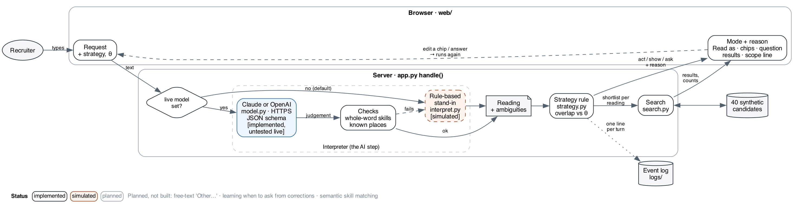

# Ask, Show, or Just Do It?
### Handling vague requests in an AI search assistant

A recruiter types a vague candidate search, such as *"senior Java developers in London"*. The
assistant notices what is unclear and decides whether to **act** (just search), **show** its reading as
editable chips, or **ask** one clarifying question, and it always says why. Built as an MSc project at
the University of Birmingham.

*README prose: about 850 words (code, commands and tables not counted).*

## Project status

| Part | Status |
|---|---|
| Search over 40 synthetic candidates (skills AND/OR, location, seniority, notice, work mode) | implemented |
| Act mode: results with a "Read as" line built from the filters that ran | implemented |
| Show mode: editable chips, one-click AND/OR, "(guessed)" marks, reset | implemented |
| Ask mode: one question, each option with its real result count | implemented |
| The rule choosing act, show or ask, with its reason; strategy switch and threshold slider | implemented |
| Interpreter, default: rule-based stand-in for a language model | **simulated** |
| Interpreter, live: Claude or OpenAI with structured outputs, checked by code | implemented, untested live |
| Event log for evaluation (`logs/events.jsonl`) | implemented |
| Free-text "Other…" on chips and questions; learning when to ask from corrections; semantic skill matching | planned |



**How it works:** the interpreter turns the request into one structured *reading* plus the parts that
are unclear. For each unclear part, the rule compares the shortlists the readings would give:
- nothing unclear → **act**;
- one reading is clearly meant, or the lists barely differ → **show**;
- otherwise → **ask** about the part whose readings differ most.

The model only *judges*: code checks its reply (skills must be words the user wrote, places must exist
in the data) and builds every option, count and message from the search that actually ran.

## Technology stack

- **Python 3.8+, standard library only.** No packages to install. `http.server` serves the page.
- **One HTML page** with plain JavaScript and CSS; no framework.
- **Synthetic data** in `data/candidates.json`. No real people and no data from any real product.
- **Optional live models**, called over HTTPS with `urllib`:
  - Claude (`claude-opus-5-5`) through the Anthropic Messages API (API version `2026-10-21`);
  - an OpenAI model through Chat Completions (default `gpt-5-mini`; set `A2_OPENAI_MODEL` to one your
    account offers).

  Both use structured outputs, so the reply must match one JSON schema.
- **Undecided:** which live model to report results with. That depends on the comparison planned for
  the evaluation.

## Running or inspecting the work

```bash
python3 run_tests.py          # 77 tests, no key or network needed
python3 app.py                # then open http://127.0.0.1:8770
```

Try these requests:
- *Java developers in London* → act
- *Java with Python in London* → show (flip the AND chip)
- *senior Java developers* → ask
- *Python and AWS people with Senior in the title* → the motivating example below

Use the **Strategy** setting to force a mode and compare.

**Live model (optional):**
```bash
cp .env.example .env          # then set A2_MODEL=claude + ANTHROPIC_API_KEY, or A2_MODEL=openai + OPENAI_API_KEY
python3 app.py
```
`.env` is ignored by git; never commit a key. Live mode sends only the typed request to the provider;
candidate data stays on your machine. If the model can't be used, the page falls back to the stand-in
and says so.

**Code map:**

| File | Job |
|---|---|
| `app.py` | server and `handle()` |
| `interpret.py` | stand-in interpreter and the checks on model replies |
| `model.py` | live Claude or OpenAI call |
| `strategy.py` | the act/show/ask rule |
| `search.py` | filters and the "Read as" line |
| `log.py` | event log |
| `web/` | the page |

## Development record

The motivating failure: an assistant over a recruitment CRM silently widened a user's "and" to OR,
labelled an off-title candidate a "standout", and claimed a notes search it never ran. Each stage below
links its pull request, where the reasons and checks are written up.

1. **Search and synthetic data** ([#9](https://github.com/ar-pavel/ambiguity-aware-ai-search/pull/9)). I chose explicit filters over embeddings so every result can be explained. The data was built so the ambiguities matter: Senior titles with few years, experienced people without Senior in the title.
2. **Interpreter** ([#10](https://github.com/ar-pavel/ambiguity-aware-ai-search/pull/10)). I changed from recorded replies for fixed requests to a rule-based stand-in, so any request using the known skills and places works. A test pins that "and" is never widened to OR.
3. **The rule** ([#11](https://github.com/ar-pavel/ambiguity-aware-ai-search/pull/11)). A hand-set overlap threshold rather than a learned policy, because which strategy works better is the open question.
4. **Agent skills** ([#12](https://github.com/ar-pavel/ambiguity-aware-ai-search/pull/12)): `review-change` and `add-scripted-request`. I used the first to review the PRs that followed.
5. **Act mode** ([#13](https://github.com/ar-pavel/ambiguity-aware-ai-search/pull/13)). The "Read as" line is built from the executed filters, and a scope line says what was *not* searched. A security review then found the server answered any caller; it now accepts only local requests.
6. **Show mode** ([#14](https://github.com/ar-pavel/ambiguity-aware-ai-search/pull/14)): editable chips; one click flips AND/OR and shows the new count.
7. **Live Claude interpreter** ([#16](https://github.com/ar-pavel/ambiguity-aware-ai-search/pull/16)).
   - I first used the SDK, then switched to plain HTTPS: the SDK needs Python 3.10+ and an install.
   - My review found three ways a model reply could mislead the page (a skill matched inside another word, an unknown place silently matching nobody, a malformed reply crashing). Each was fixed with a test.
8. **OpenAI as an alternative** ([#18](https://github.com/ar-pavel/ambiguity-aware-ai-search/pull/18)), so a reviewer with either key can run it. Both providers share one prompt, schema and set of checks.
9. **Ask mode** ([#19](https://github.com/ar-pavel/ambiguity-aware-ai-search/pull/19)). Review found the question could quote the model's own wording. Questions are now built from the reading only.
10. **Controls** ([#20](https://github.com/ar-pavel/ambiguity-aware-ai-search/pull/20)): strategy switch, threshold slider and an interpreter label. Review kept the "simulated" label when a live model fails.
11. **Event log** ([#21](https://github.com/ar-pavel/ambiguity-aware-ai-search/pull/21)) for evaluating the strategies.
12. **Diagram and storyboards** ([#23](https://github.com/ar-pavel/ambiguity-aware-ai-search/pull/23)). The first diagram was hard to follow: the request reached the live model by no visible path. I redrew it around an explicit "live model set?" decision. The storyboard screenshots were cropped and enlarged until the text could be read.

## AI assistance

Developed utilising Claude Code. Details will be added before submission.

## Additional files

- `AGENTS.md`: working rules for coding agents (and people). `skills/`: two task procedures.
- `.env.example`: settings for live mode and logging.
- `logs/events.jsonl`: created locally when the app runs; ignored by git.
- `docs/system.png` (source `docs/system.dot`): system and workflow diagram, with each part marked implemented, simulated or planned.
- `docs/storyboards/`: three five-frame storyboards (act, show, ask) built from real screenshots. `make_storyboards.py` regenerates the pages.
